# MediCheck Reminder

[](https://github.com/TlouPheme/medicheck-reminder/actions/workflows/android.yml)

MediCheck Reminder is an Android app that helps a person take medication on schedule. They add each medication, receive a reminder at the scheduled time, and mark the dose taken, skipped, or snoozed. History shows those outcomes for the last 7 days, the last 30 days, or a custom range. The same app records weight, blood pressure, and blood sugar. The interface is available in English, isiZulu, and Afrikaans.

Part 3 adds Google sign-in, offline mode with Firestore sync, a refill calculator, push notifications, an escalating full-screen alarm, and a profile photo. It also prepares the app for a Play Store release. Every change since the prototype is listed in [RELEASE_NOTES.md](RELEASE_NOTES.md), and the final version is tagged [`v1.0-final-poe`](https://github.com/TlouPheme/medicheck-reminder/releases/tag/v1.0-final-poe).

- **Part 3 demonstration:** _YouTube link to be added after recording_ (script: [docs/demo-video-script.md](docs/demo-video-script.md))
- **Part 2 demonstration:** [MediCheck Reminder demo](https://youtu.be/Chz8wPsceyg)

## Students

- ST10177726 - Tlou Pheme
- ST10286000 - Ayanda Rikhotso
- ST10384687 - Angel Kgafela
- ST10451890 - Lerato Mojalefa
- ST10457083 - Hlompho Petja

## Screenshots

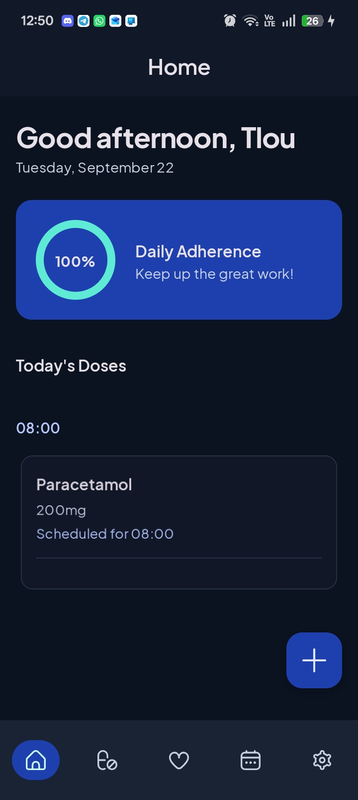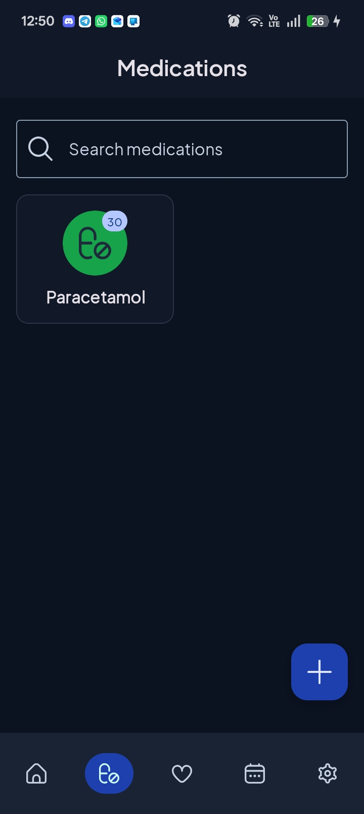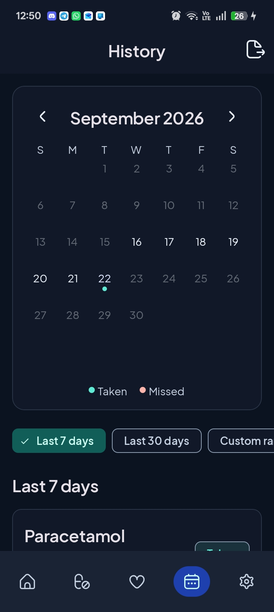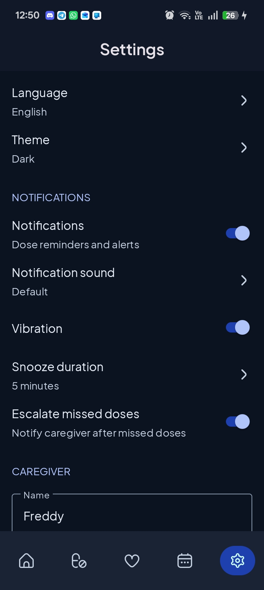

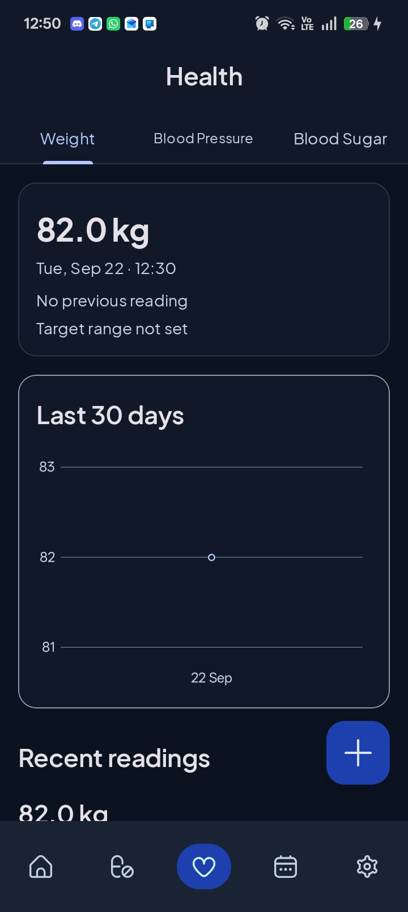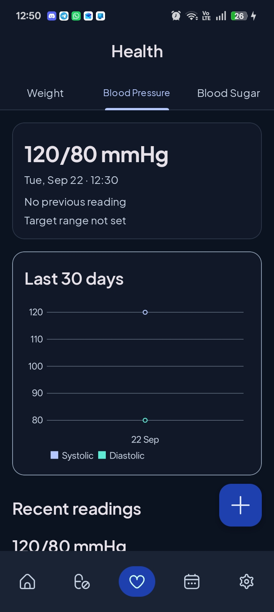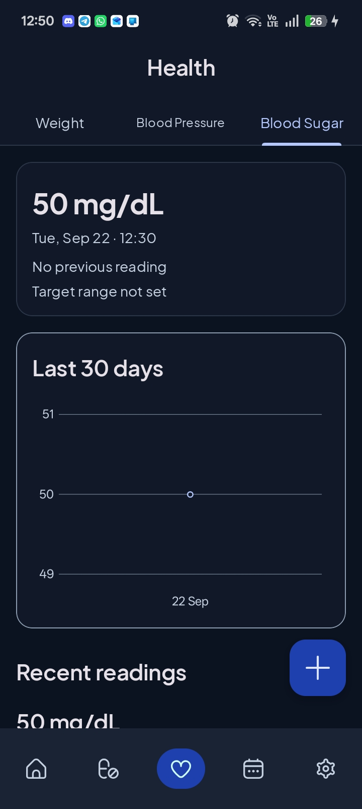

Part 3, captured on a physical phone (OnePlus, Android 16):

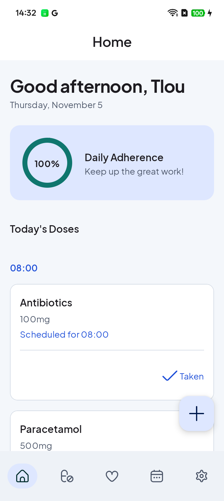 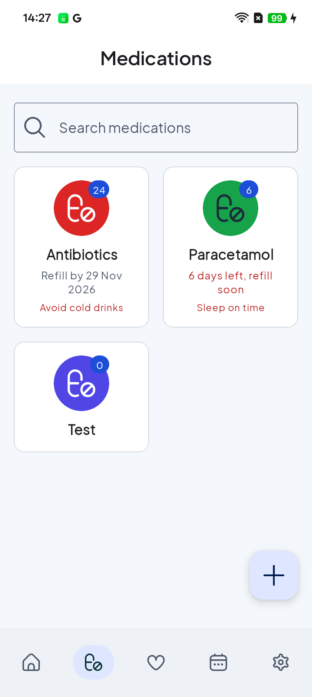 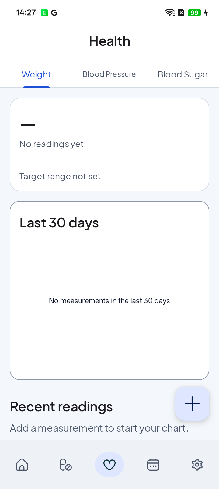 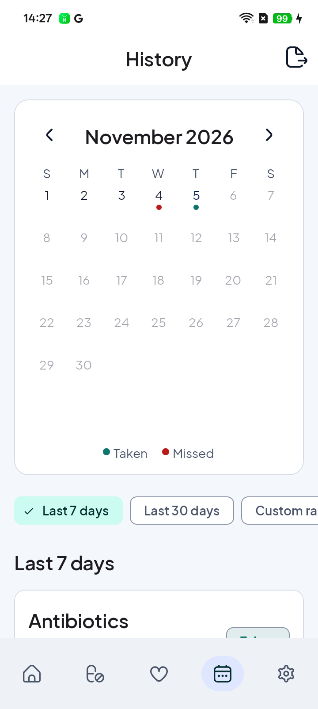 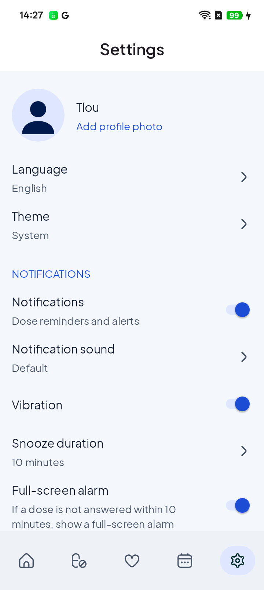

## Design considerations

Room stores medications, dose logs, and health readings on the phone. The account, an email and a salted password hash, is kept in encrypted preferences, so email login still works without a connection. Reminders are scheduled on the device, so a dose alert does not depend on a network connection. Since Part 3, every record is also synced to Cloud Firestore, so it moves with the person to a new phone (see [Offline mode and sync](#offline-mode-and-sync)).

History begins on the day a medication is added. Earlier days are left empty, because the person was not using the app yet and those doses were not missed.

Reminders use `AlarmManager`. The notification offers Taken and Snooze. Snooze uses the duration chosen in Settings. When missed-dose escalation is on, a follow-up notification can open a message or an email to the caregiver saved in Settings. Alarms are rebuilt when medications or reminder settings change, and again after the phone restarts. On Android 12 and later, exact delivery needs the system Alarms and reminders permission. Without it, the alert can arrive a little later.

The interface follows Material 3, with Plus Jakarta Sans, and draws edge to edge so text stays clear of the camera cutout and the system navigation bar. Icons are Uicons by Flaticon, credited on the Settings screen. Each medication keeps one pill color derived from its name, so the cabinet stays recognizable after the name is saved.

Language is applied with per-app locales (`en`, `zu`, and `af`). Screen titles, buttons, errors, and health labels come from string resources, so changing the language replaces the interface rather than a few words.

History can export the doses in the selected period as a PDF and hand that file to the system share sheet.

## Sign-in

A person can register with an email and password, or tap **Sign in with Google**. Google sign-in uses Android Credential Manager to choose the account, then exchanges the Google ID token for a Firebase Authentication session.

Both methods resolve to one user record. An email sign-up creates a Firebase Auth account with the same email and password, and Google sign-in uses Firebase's default "one account per email address" rule. A Google account and a password account with the same email therefore share one Firebase `uid`. The profile is written to Firestore at `users/{uid}` with a merge (email, display name, linked providers, and the last sign-in time). The write is not awaited, so Firestore sends it when the phone is next online.

Sign-in failures are handled without a crash. A cancelled account picker simply returns to the login screen. No Google account on the phone, no network, and a timeout each show a message. The Google button is hidden when the build has no `google-services.json`, so a clone without Firebase still builds and offers email login.

### Firebase setup (once per team)

1. Create a Firebase project and add an Android app with package `com.example.medicheckreminder`.
2. Add each developer's debug SHA-1 (`./gradlew signingReport`) and the release key's SHA-1.
3. Enable **Authentication → Google** and **Authentication → Email/Password**, and create a Firestore database.
4. Paste [`firestore.rules`](firestore.rules) into **Firestore → Rules** and publish them, before the test-mode rules expire.
5. Download `google-services.json` into `app/`. It is listed in `.gitignore`.

## Offline mode and sync

Every change is saved to Room on the phone first, so the app works the same with no connection. Medications, dose logs and health readings each carry an `updatedAt` time and a `pendingSync` flag. A change made offline stays flagged until it reaches Firestore.

Each change queues a WorkManager job with a network constraint. The job waits until the phone is online, even if the app has been closed, and then runs `FirestoreSyncEngine`. That engine compares every record on the phone with Firestore at `users/{uid}/medications`, `users/{uid}/doseLogs` and `users/{uid}/health`. The conflict rule is **last write wins**: the copy with the newer `updatedAt` is kept, whichever side it is on. Deletes are sent as a `deleted` marker, so a medication removed on one phone is removed on the others. The app reads from Firestore as well as writing to it. Signing in on a new phone pulls the person's data down.

The phone holds one person's data. If a different account signs in, the previous account's local data is cleared before anything is uploaded. A banner on Home shows whether the phone is offline, has changes waiting, or is syncing. Tap it to sync straight away.

The Firestore rules are in [`firestore.rules`](firestore.rules): each user can read and write only `users/{their uid}`.

### Demo steps (offline sync)

1. Sign in, open **Home**, and show that no banner is visible.
2. Turn on **airplane mode**. The banner says *You're offline. Changes are saved on this phone.*
3. Add a medication. The banner now counts *1 change will sync when you reconnect*.
4. Turn airplane mode **off**. The banner shows *Syncing your data…* and then disappears.
5. In the Firebase console, open **Firestore → users → (your uid) → medications** and show the new document. Its `updatedAt` matches the time it was added offline.

## Refill calculator (user-defined feature 4)

Marking a dose **Taken** takes one from that medication's stock, and changing it back puts one back. From the stock and the schedule, the app works out how many days are left and the date a refill is needed. The pill cabinet card shows *Refill by …*, or turns red once a week or less is left. When the supply first drops to seven days, a **refill reminder** notification is shown once. Each medication can also hold **drug interaction notes** from a pharmacist (for example "avoid grapefruit"), which show on its card. The calculation is in `RefillCalculator` and is covered by unit tests.

## Push notifications

Firebase Cloud Messaging is handled by `MediCheckMessagingService`. After sign-in, the phone's FCM token is added to `users/{uid}.fcmTokens` in Firestore, and it is updated whenever FCM changes it. A push can therefore reach every phone the person uses. On Android 13 and later the app asks for notification permission on first launch. Pushes appear on their own **Updates and alerts** channel. A push can carry a `screen` value (`home`, `medications`, `history`, `health` or `settings`), and tapping it opens that tab. The refill reminder uses the same mechanism to open **Medications**. **Settings → Push notifications** turns pushes off: the phone's token is removed from Firestore and from FCM, so nothing more is delivered. Signing out removes it as well.

Sending a push from a real app event needs a Cloud Function, and Cloud Functions require Firebase's paid Blaze plan, which this project does not use. Pushes are therefore sent from the Firebase console (**Messaging → New campaign → Send test message**), as the brief allows.

### Demo steps (push)

1. Sign in on the phone, then open **Firestore → users → (your uid)** and copy one value from `fcmTokens`.
2. In the Firebase console, open **Messaging → Create your first campaign → Firebase Notification messages**. Enter a title and text, click **Send test message**, paste the token and click **Test**.
3. To show tap-to-open, go to **Additional options → Custom data** and add key `screen` with value `medications`. With the app closed, tapping the notification opens the Medications tab.
4. Turn **Settings → Push notifications** off and send the test again. Nothing arrives, and the token has gone from Firestore.

## Full-screen alarm (user-defined feature 5)

This is Part 1's escalating reminder (FR-INN-01). If a dose reminder is not answered within **10 minutes**, it turns into a **full-screen alarm**. With the phone locked, the alarm wakes the screen and shows over the lock screen. While the phone is in use, it appears as a heads-up alert. The alarm plays the alarm sound, starting quietly and getting louder every two seconds, and vibrates until it is answered. It offers **Taken**, **Snooze** and **Skip**, which work like the notification buttons. Taken also lowers the stock for the refill calculator. Snoozing re-arms the alarm with the next reminder. No alarm rings for a dose that was already answered (`AlarmPolicy`). It can be turned off under **Settings → Full-screen alarm**.

### Demo steps (alarm)

1. Add a medication due in two minutes, and lock the phone.
2. When the reminder appears, ignore it.
3. Ten minutes later the alarm wakes the screen. Tap **Taken**: the alarm stops, and Home shows the dose as taken.

## Profile photo

Settings has a profile row. Tapping it opens the system photo picker. The chosen photo is shrunk on the phone to at most 512 px, uploaded as a JPEG to Firebase Storage at `profile_pictures/{uid}.jpg`, and its download URL is saved on `users/{uid}` in Firestore. The upload uses the signed-in Firebase user. [`storage.rules`](storage.rules) lets each user read and write only their own photo, as a JPEG under 2 MB. Firebase Storage needs the Blaze plan, so the upload does not work on this project's free plan (see [Known limitations](#known-limitations)).

## Release and Play Store

Release builds are signed with an upload key that is kept **outside** the repository. Gradle reads it from `keystore.properties`, which `.gitignore` excludes. Without that file the release build is unsigned, so CI and other team members can still build. The version is **3 / 3.0.0**.

```bash
./gradlew :app:bundleRelease
```

```bash
./gradlew :app:assembleRelease
```

The store listing, graphics, data safety answers and screenshots are in [docs/play-store/store-listing.md](docs/play-store/store-listing.md). The privacy policy is [docs/privacy-policy.md](docs/privacy-policy.md), which the app's **Privacy** link opens. The group has no Play Console account, so the app was not uploaded. The signed APK is attached to the [`v1.0-final-poe` release](https://github.com/TlouPheme/medicheck-reminder/releases/tag/v1.0-final-poe).

## Known limitations

- **Profile photo and server-sent pushes need the paid plan.** Firebase Storage and Cloud Functions both require Firebase's Blaze plan. The project is on the free Spark plan, so profile photo upload does not work ([#8](https://github.com/TlouPheme/medicheck-reminder/issues/8)), and pushes are sent from the Firebase console rather than from an app event.
- **Package name.** Google Play does not accept the `com.example` package name. It has to change before a real upload ([#9](https://github.com/TlouPheme/medicheck-reminder/issues/9)).
- **Pill icon.** The icon reads as a "no medication" symbol ([#7](https://github.com/TlouPheme/medicheck-reminder/issues/7)).

## Use of AI

How generative AI was used, and how its output was checked, is described in [docs/ai-use-write-up.md](docs/ai-use-write-up.md).

## GitHub

Source is hosted at [github.com/TlouPheme/medicheck-reminder](https://github.com/TlouPheme/medicheck-reminder). `main` is the branch that holds the shared history. Each Part 3 feature was built on its own branch and merged through a pull request:

| Pull request | Branch | Area |
| --- | --- | --- |
| [#1](https://github.com/TlouPheme/medicheck-reminder/pull/1) | `feature/sso` | Google sign-in, unit tests, GitHub Actions |
| [#2](https://github.com/TlouPheme/medicheck-reminder/pull/2) | `feature/profile-photo-ui` | Profile photo, launcher icon, store graphics |
| [#3](https://github.com/TlouPheme/medicheck-reminder/pull/3) | `feature/offline-sync` | Offline mode with sync, refill calculator |
| [#4](https://github.com/TlouPheme/medicheck-reminder/pull/4) | `feature/push-notifications` | Push notifications, full-screen alarm |
| [#5](https://github.com/TlouPheme/medicheck-reminder/pull/5) | `feature/release-prep` | Signed release, store listing, device-testing fix |
| [#10](https://github.com/TlouPheme/medicheck-reminder/pull/10) | `docs/final-wrap-up` | README and release notes |

A pull request is merged only once its GitHub Actions build is green. The team rules also asked for another member to review each pull request. Because of the deadline, none of these pull requests has a recorded GitHub review. Bugs found while testing on a physical phone are tracked as [GitHub Issues](https://github.com/TlouPheme/medicheck-reminder/issues). The final submitted commit is tagged [`v1.0-final-poe`](https://github.com/TlouPheme/medicheck-reminder/releases/tag/v1.0-final-poe).

## GitHub Actions

[`.github/workflows/android.yml`](.github/workflows/android.yml) runs on every push, on any branch, and on every pull request. The job:

1. checks out the repository and sets up Temurin JDK 21 and Gradle caching;
2. sets up the Android SDK with `android-actions/setup-android` and installs the API 37 platform (`platforms;android-37.0`);
3. runs the unit tests with `./gradlew :app:testDebugUnitTest`;
4. builds the debug app with `./gradlew :app:assembleDebug`;
5. uploads the test report and the debug APK as build artifacts.

A green run means the app compiles on a clean machine and every unit test passes. The result is shown on the commit and on the pull request. The runner has no `google-services.json`, so it builds the app with Google sign-in switched off.

## Testing

There are 66 unit tests in [`app/src/test`](app/src/test). They run on the JVM:

| Test | Covers |
| --- | --- |
| `UserProfileTest` | The Firestore user record shared by email and Google sign-ins |
| `GoogleSignInErrorsTest` | Cancelled, no-account, and no-network sign-in outcomes |
| `PasswordValidatorTest` | Password complexity and the strength meter |
| `MedicationValidatorTest` | Add/edit medication rules and days of stock remaining |
| `DoseScheduleTest` | Daily, specific-day and interval schedules, missed doses |
| `SouthAfricanPhoneValidatorTest` | Caregiver phone numbers |
| `SyncResolverTest` | Last-write-wins decisions, offline edits and deletes |
| `SyncMappersTest` | Room rows to Firestore documents and back |
| `SyncStatusRulesTest` | The offline / syncing banner |
| `RefillCalculatorTest` | Days remaining, refill date, low-stock reminder, stock changes |
| `ImageScalingTest` | Shrinking profile photos before upload |
| `PushRoutesTest` | Push message parsing and which screen a tap opens |
| `AlarmPolicyTest` | When the full-screen alarm rings |

Run them locally with:

```bash
./gradlew :app:testDebugUnitTest
```
